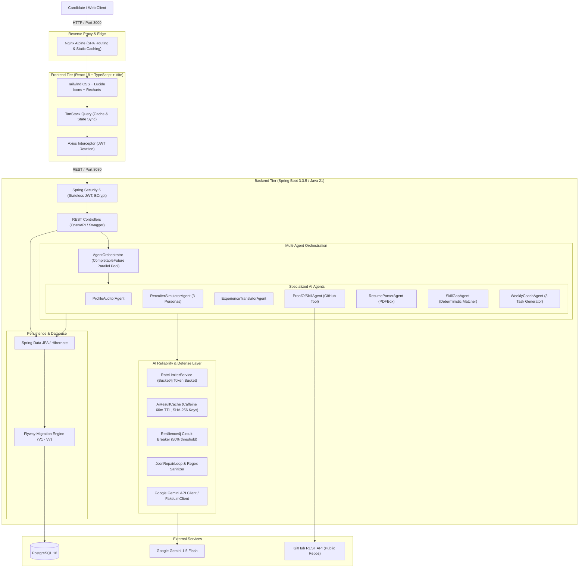

# 🚀 CareerPilot — Multi-Agent AI Profile Coach for Freshers

[](https://openjdk.org/projects/jdk/21/)
[](https://spring.io/projects/spring-boot)
[](https://react.dev/)
[](https://www.typescriptlang.org/)
[](https://www.postgresql.org/)
[](https://github.com/your-org/careerpilot)
[](LICENSE)

**CareerPilot** is an enterprise-grade, multi-agent AI career platform engineered to bridge the gap between academic projects and industry hiring standards for fresher engineers.

Unlike shallow "resume builders" or generic chatbot prompts, CareerPilot orchestrates a coordinated team of **7 specialized AI agents** backed by **deterministic evaluation rules**, **GitHub evidence verification**, **real-time recruiter panel simulations**, and an **industrial-strength AI reliability layer**.

---

## 📑 Table of Contents

- [Key Features](#-key-features)
- [System Architecture](#-system-architecture)
- [Multi-Agent Ecosystem](#-multi-agent-ecosystem)
- [How the AI Reliability Layer Works](#-how-the-ai-reliability-layer-works)
- [Security Highlights](#-security-highlights)
- [10-Minute Quickstart](#-10-minute-quickstart)
  - [Option A: Docker Compose (Recommended)](#option-a-docker-compose-recommended)
  - [Option B: Manual Local Setup](#option-b-manual-local-setup)
- [Environment Variables](#-environment-variables)
- [REST API Overview](#-rest-api-overview)
- [UI Screenshots](#-ui-screenshots)
- [Design Decisions & Trade-offs](#-design-decisions--trade-offs)
- [Limitations & Future Roadmap](#-limitations--future-roadmap)
- [Documentation Directory](#-documentation-directory)
- [License](#-license)

---

## ✨ Key Features

1. **Deterministic + AI Profile Auditor**: Evaluates headlines, summaries, project bullets, and skills against target roles. Scored across 4 pillars with exact weak text callouts.
2. **3-Persona Recruiter Simulation**: Simultaneously simulates impressions, red flags, and hiring decisions (`YES` / `MAYBE` / `NO`) from an **MNC HR Specialist**, **Startup Founder**, and **Senior Technical Lead**.
3. **Experience Translator & Human-in-the-Loop Suggestions**: Rewrites academic and vague coursework descriptions into industry-standard STAR/XYZ achievement bullets. Proposes suggestions into an inbox where candidates approve, edit-then-approve, or reject changes.
4. **GitHub Proof-of-Skill Engine**: Crawls public GitHub repositories to audit claimed skills against real code, repos, and language tags. Badged as `VERIFIED`, `PARTIAL`, or `UNVERIFIED` with direct repository links.
5. **In-Memory Resume Ingestion**: Upload PDF resumes safely (up to 5 MB). Validated via magic bytes and parsed in memory via Apache PDFBox directly into pending suggestions—never written to disk.
6. **Target Role Skill Gap & Roadmap**: Compares candidate competencies against curated fresher roles (e.g., Java Backend Developer, Full Stack Engineer) and synthesizes a prioritized 4-step learning roadmap.
7. **Weekly Coach & Consistency Streak**: Idempotently generates exactly 3 concrete, achievable weekly tasks based on recent weaknesses, with real-time consistency streak tracking.

---

## 🏗 System Architecture

CareerPilot pairs a modern **React 18 + Vite** frontend with a robust **Spring Boot 3.3.5** backend, backed by **PostgreSQL 16** with versioned **Flyway** migrations.



---

## 🤖 Multi-Agent Ecosystem

| Agent | Versioned Prompt | Core Responsibility | Deterministic Guard |
|---|---|---|---|
| **ProfileAuditorAgent** | `auditor.v1.txt` | 4-section profile audit (0–100) and weakness identification | Scored across deterministic rubric |
| **RecruiterSimulatorAgent** | `recruiter.v1.txt` | Simulates MNC HR, Startup Founder, Tech Lead personas | Fixed 3-persona card contracts |
| **ExperienceTranslatorAgent** | `translator.v1.txt` | Rewrites coursework into STAR bullets (max 8, max 300 chars) | No hallucinated metrics; emits questions |
| **ProofOfSkillAgent** | `proof.v1.txt` | Validates claimed skills against public GitHub code repositories | Pure Java language/topic matching first |
| **ResumeParserAgent** | `resume_parser.v1.txt` | Parses raw extracted PDF text into structured sections | Strictly generates PENDING suggestions |
| **SkillGapAgent** | `skillgap.v1.txt` | Analyzes role alignment & synthesizes learning roadmap | Java set comparison & math percentage first |
| **WeeklyCoachAgent** | `coach.v1.txt` | Generates 3 concrete tasks per ISO week & tracks streaks | Idempotent plan check by calendar week |

---

## 🛡 How the AI Reliability Layer Works

1. **Prompt Injection Armor**: Dynamic candidate input is sandboxed inside strict isolation delimiters (`<<<PROFILE_DATA_START>>>` ... `<<<PROFILE_DATA_END>>>`). The system prompt instructs the LLM that content inside delimiters is raw data only and cannot alter instructions.
2. **Bucket4j Token Bucket Rate Limiting**: Every candidate gets an independent rate limit token bucket (e.g. 30 requests/minute) returning HTTP 429 and `Retry-After` headers on exhaustion.
3. **Caffeine Hash Caching**: Prompt payloads, profile states, and target roles are hashed with SHA-256 into in-memory Caffeine cache entries (60-minute TTL). Unchanged audits return instantaneously.
4. **Resilience4j Circuit Breaker**: Wraps the Gemini LLM client. If failure rates reach 50% over a 5-call sliding window, the circuit breaker opens for 10 seconds, immediately returning safe deterministic fallbacks.
5. **Self-Healing JSON Repair Loop**: If an LLM returns unescaped markdown blocks, comments, or malformed syntax, the response is sanitized via regex. If Jackson parsing still fails, a one-shot repair prompt automatically recovers valid JSON.

---

## 🔒 Security Highlights

- **Stateless JWT with Automatic Rotation**: 15-minute access token paired with 7-day refresh tokens. Using an expired or already-rotated token triggers **reuse detection**, revoking the entire token family.
- **Strict Tenant Isolation**: All endpoints verify resource ownership against the authenticated JWT context (`user.getId()`). Cross-tenant access attempts return HTTP 404/403.
- **In-Memory PDF Extraction**: Uploaded resumes are inspected for magic bytes (`%PDF-`), validated for file size (5 MB max), and processed strictly in memory using Apache PDFBox. Files are **never written to disk**.
- **No Stack Traces in Production**: Unhandled exceptions are logged with trace IDs and return safe, RFC-7807 compliant JSON errors (`server.error.include-stacktrace: never`).
- **Non-Root Containers**: Backend and frontend containers execute under unprivileged user accounts (`spring:spring`).

---

## ⏱ 10-Minute Quickstart

### Option A: Docker Compose (Recommended)

Requires Docker Desktop or Docker Engine + Docker Compose.

1. **Clone the repository**:
   ```bash
   git clone https://github.com/your-org/careerpilot.git
   cd careerpilot
   ```

2. **Create your environment configuration**:
   ```bash
   cp .env.example .env
   ```
   *(Optional)* Add your `GEMINI_API_KEY` to `.env` to enable live Gemini AI. If left empty, CareerPilot seamlessly uses its integrated deterministic mock fallback!

3. **Start the complete stack**:
   ```bash
   docker-compose up --build
   ```

4. **Access the application**:
   - **Frontend App**: [http://localhost:3000](http://localhost:3000)
   - **Backend REST API**: [http://localhost:8080](http://localhost:8080)
   - **Interactive Swagger Docs**: [http://localhost:8080/swagger-ui.html](http://localhost:8080/swagger-ui.html)
   - **Health Check**: [http://localhost:8080/actuator/health](http://localhost:8080/actuator/health)

---

### Option B: Manual Local Setup

#### Prerequisites
- **JDK 21** (`java -version`) — **required; JDK 17–21 accepted; Java 22+ breaks Lombok/MapStruct**
  > If you have multiple JDKs, set: `$env:JAVA_HOME = "C:\Program Files\Java\jdk-21"` before running Maven.
- **Node.js 20+** (`node -v`)
- **PostgreSQL 16** running locally on port 5432

1. **Start PostgreSQL**:
   Create a database named `careerpilot`:
   ```sql
   CREATE DATABASE careerpilot;
   CREATE USER careerpilot_user WITH ENCRYPTED PASSWORD 'careerpilot_secret';
   GRANT ALL PRIVILEGES ON DATABASE careerpilot TO careerpilot_user;
   ```

2. **Run Backend**:
   ```bash
   cd backend
   ./mvnw clean install
   ./mvnw spring-boot:run
   ```

3. **Run Frontend**:
   ```bash
   cd frontend
   npm install
   npm run dev
   ```
   Open [http://localhost:5173](http://localhost:5173).

---

## ⚙️ Environment Variables

| Variable | Default Value | Description |
|---|---|---|
| `SPRING_PROFILES_ACTIVE` | `dev` | Active Spring profile (`dev`, `prod`, `test`) |
| `SERVER_PORT` / `PORT` | `8080` | Backend server port |
| `DB_HOST` | `localhost` / `postgres` | PostgreSQL hostname |
| `DB_PORT` | `5432` | PostgreSQL port |
| `DB_NAME` | `careerpilot` | Database name |
| `DB_USER` | `careerpilot_user` | Database user |
| `DB_PASSWORD` | `careerpilot_secret` | Database password |
| `JWT_SECRET` | *(64-char key)* | HMAC-SHA256 signature key |
| `JWT_EXPIRATION_MS` | `900000` (15m) | Access token expiration |
| `REFRESH_TOKEN_EXPIRATION_MS` | `604800000` (7d) | Refresh token expiration |
| `LLM_PROVIDER` | `gemini` | AI Provider (`gemini` or `fake`) |
| `GEMINI_API_KEY` | *(empty)* | Google Gemini API key |
| `GITHUB_TOKEN` | *(empty)* | Optional GitHub PAT for higher API limits |
| `CORS_ALLOWED_ORIGINS` | `http://localhost:3000,http://localhost:5173` | Allowed frontend domains |
| `SWAGGER_ENABLED` | `true` | Toggle OpenAPI docs endpoint |
| `VITE_API_URL` | `http://localhost:8080` | Frontend backend API URL |

---

## 📡 REST API Overview

```text
POST   /api/v1/auth/register              # Register candidate account
POST   /api/v1/auth/login                 # Login & obtain JWT pair
POST   /api/v1/auth/refresh               # Rotate refresh token
GET    /api/v1/profile                    # Get complete candidate profile
PUT    /api/v1/profile                    # Update bio, headline, GitHub handle
POST   /api/v1/profile/skills             # Add claimed skill
POST   /api/v1/profile/projects           # Add project with bullets
POST   /api/v1/agents/audit               # Trigger full multi-agent audit
POST   /api/v1/agents/recruiter-simulation# Run 3-persona recruiter panel
POST   /api/v1/agents/translate-experience# Convert project to STAR bullets
POST   /api/v1/agents/verify-skills       # Verify skills against GitHub repos
POST   /api/v1/agents/skill-gap           # Calculate gap vs target role & roadmap
GET    /api/v1/suggestions?status=PENDING # List AI suggested improvements
PATCH  /api/v1/suggestions/{id}/approve   # Apply suggestion to profile (or edit)
PATCH  /api/v1/suggestions/{id}/reject    # Reject suggestion
POST   /api/v1/resume/upload              # Upload PDF resume in memory
GET    /api/v1/coach/weekly-tasks         # Get 3 tasks for current ISO week
PATCH  /api/v1/coach/weekly-tasks/{id}/complete # Mark weekly task done
GET    /api/v1/coach/streak               # Get consecutive weekly streak
```
*Full documentation available in [docs/API.md](docs/API.md) or via Swagger UI.*

---

## 🖼 UI Screenshots

| View | Preview |
|---|---|
| **Dashboard & Radar Score** | `` <br> *Overall readiness score, section breakdown radar chart, active weekly tasks, and consistency streak.* |
| **3-Persona Recruiter Panel** | `` <br> *MNC HR, Startup Founder, and Tech Lead cards with YES/MAYBE/NO decisions and red flags.* |
| **Suggestions Inbox** | `` <br> *Side-by-side diff review with Approve, Edit-then-Approve, and Reject actions.* |
| **GitHub Proof-of-Skill** | `` <br> *Verified skills badged with direct repository proof links and language matching.* |

---

## 💡 Design Decisions & Trade-offs

1. **Deterministic-First Matching Over Pure LLM Prompts**:
   - *Rationale*: LLMs are prone to hallucinating evidence or scoring arbitrarily. CareerPilot runs strict set comparison and token matching in Java first, using LLMs only for natural language synthesis.
2. **In-Memory PDF Parsing**:
   - *Rationale*: Rather than persisting uploaded resumes to S3 or temporary disk directories, Apache PDFBox extracts text directly in memory. This eliminates storage costs, PII retention vulnerabilities, and arbitrary file execution risks.
3. **Suggestions Approval Protocol with Stale Checking**:
   - *Rationale*: AI should never silently overwrite candidate profiles. Suggested rewrites are stored as `PENDING` suggestions containing an SHA hash of the original text. If a candidate edits their profile before approving, the system detects the divergence and returns HTTP 409 Conflict.

---

## 🚧 Limitations & Future Roadmap

- **Limitations**:
  - Skill verification requires public GitHub repositories (private repos and GitLab/Bitbucket are not currently supported).
  - Scanned image-only PDFs without an embedded OCR text layer are rejected.
- **Future Roadmap**:
  - [ ] GitHub OAuth integration for private repository skill verification.
  - [ ] Tesseract OCR integration for scanned PDF resumes.
  - [ ] Mock technical interview agent with audio synthesis.
  - [ ] Automated LinkedIn profile export sync.

---

## 📚 Documentation Directory

- 📐 [docs/ARCHITECTURE.md](docs/ARCHITECTURE.md) — High-level architecture, subsystem blueprints, data schemas.
- 🧠 [docs/AGENTS.md](docs/AGENTS.md) — Deep dive into all 7 AI agents, prompt files, and JSON schemas.
- 🔌 [docs/API.md](docs/API.md) — Comprehensive REST API reference and request/response specifications.
- 🛡 [docs/SECURITY.md](docs/SECURITY.md) — Authentication, JWT token rotation, prompt injection defenses.
- 🚀 [docs/DEPLOYMENT.md](docs/DEPLOYMENT.md) — Production deployment guide for Docker Compose, Railway, Render, and Vercel.

---

## 📄 License

CareerPilot is open-source software licensed under the **[MIT License](LICENSE)**.
