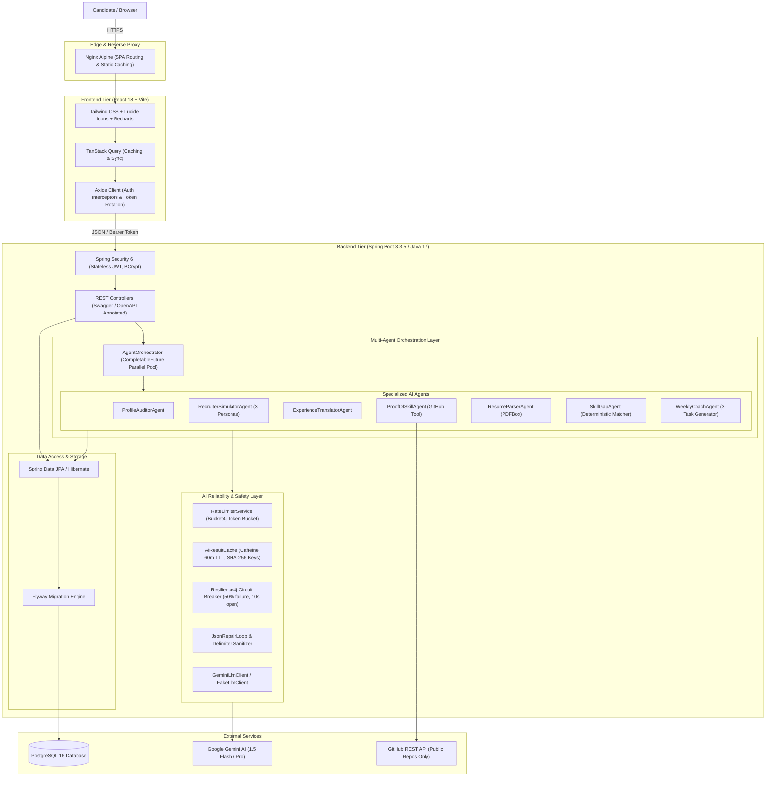

# CareerPilot Architecture & System Design

CareerPilot is an enterprise-grade, multi-agent AI career platform designed specifically to guide fresher engineers from raw profiles into market-ready job candidates. It pairs deterministic Java evaluation logic with state-of-the-art LLMs (Google Gemini), wrapped in a defense-in-depth reliability layer.

---

## 1. High-Level Architecture Diagram

---

## 2. Core Subsystems

### 2.1 Multi-Agent Orchestrator
The `AgentOrchestrator` coordinates requests across 7 specialized agents.
- **Parallel Execution**: Where subtasks are independent (e.g. running the 4-section profile auditor and the 3-persona recruiter simulation simultaneously), the orchestrator executes them concurrently using an application-managed `ExecutorService` and `CompletableFuture.allOf()`.
- **Fault-Tolerant Degraded Modes**: If one agent fails or times out, the orchestrator captures the failure gracefully via `AgentResult.failure(...)` rather than aborting the entire user request.

### 2.2 The AI Reliability & Defense Layer
LLM calls are never exposed directly to controllers. All prompts pass through a multi-stage defense pipeline:
1. **Token Bucket Rate Limiting (`RateLimiterService`)**:
   - Implemented via Bucket4j.
   - Configurable per-user token allocation (e.g. 30 requests / minute) prevents abuse, denial of service, and runaway API spend.
2. **Caffeine Hash Caching**:
   - LLM responses are cached using SHA-256 digests of the (prompt + profile state + target role).
   - Identical profile audits return in sub-millisecond time with zero external API calls.
3. **Resilience4j Circuit Breaker**:
   - Monitored parameters: 5-call sliding window, 50% failure rate threshold, 10-second open-state sleep.
   - Protects downstream services during upstream provider outages, returning sensible deterministic fallbacks.
4. **Delimiter Enclosure & Prompt Injection Armor**:
   - Untrusted user inputs are strictly wrapped in custom isolation delimiters (`<<<PROFILE_CONTENT_START>>>` ... `<<<PROFILE_CONTENT_END>>>`).
   - System prompts explicitly instruct the LLM to treat enclosed blocks purely as raw data, completely neutralizing prompt injection attempts.
5. **Self-Healing JSON Repair Loop**:
   - Responses are validated against strict Jackson schema models.
   - If an LLM returns markdown formatting, trailing commas, or invalid JSON syntax, an automatic regex-based sanitizer cleanses the payload. If parsing still fails, a one-shot repair prompt requests a corrected JSON structure from the model.

### 2.3 Deterministic-First Agent Design
To prevent LLM hallucination and ensure audit reproducibility:
- **Skill Verification**: Claimed skills are matched to GitHub repos, languages, and topics using strict Java string/token matching **before** invoking the LLM. The LLM only writes human-readable evidence summaries for verified matches.
- **Skill Gap**: Catalog roles and skill taxonomies are cross-referenced directly in Java. Match percentages and lists of matched/missing/weak skills are calculated deterministically. The LLM solely synthesizes a prioritized learning roadmap for missing skills.

---

## 3. Database Schema Overview

Flyway executes versioned schema migrations (`V1` to `V7`):
- `users`: Core identity, email, password hash, role (`USER`, `ADMIN`), timestamps.
- `refresh_tokens`: Rotational JWT refresh tokens with family tracking and reuse detection.
- `profiles`: Target role, headline, about, github_username, version.
- `profile_skills`: Skill name, claimed level, verified status (`VERIFIED`, `PARTIAL`, `UNVERIFIED`).
- `projects`: Title, role, technologies, bullet points, created/updated timestamps.
- `education`: Institution, degree, field of study, graduation year, grade/GPA.
- `audit_reports`: Section scores (headline, about, projects, skills), recruiter decisions, weaknesses.
- `agent_suggestions`: Proposed rewrites with target entity hash for 409 stale detection and human-in-the-loop approval.
- `resume_uploads`: In-memory extracted resume text records and processing status.
- `roles` & `role_skills`: Curated target job roles and prioritized prerequisite skills.
- `weekly_tasks`: Action items generated per ISO week with completion timestamps and streak tracking.
